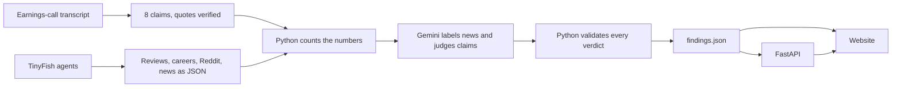

<div align="center">

# Gap

### Companies tell their own story. Gap checks it against the live web.

An AI agent that compares what listed companies say on earnings calls with what the web shows (app reviews, job pages, Reddit and news), then flags where the two disagree. Web data is collected with **TinyFish**.


**[Live demo](https://signalgapdetector.freebuff.app/)** · **[How it works](#how-it-works)** · **[Run it yourself](#run-it-yourself)**

> Not investment advice. Gap does not say a company is dishonest.

</div>

---

## The problem

Earnings calls are prepared and positive. The truth tends to show up first in places nobody tracks together: app-store reviews, careers pages, forums and the news.

- **The story is curated.** Management picks the words.
- **The evidence is scattered.** Reviews, hiring, news and Reddit live on different sites, and most have no API.
- **Nobody connects them.** Retail investors can't read every source against every claim, so mismatches surface late.

## What Gap does

1. Takes **8 checkable claims** from each earnings-call transcript. Every quote is matched word for word against the transcript.
2. Uses **TinyFish agents** to collect live evidence from four signals.
3. Counts the numbers in plain Python, then asks **Gemini** to label the news and judge each claim against that evidence only.
4. **Re-checks every verdict in code**, so the model cannot overrule the rules.
5. Shows each claim with a verdict, the evidence behind it and a link to the source.

### Verdicts

| Verdict | Meaning |
|---|---|
| **Consistent** | The evidence supports what management said. |
| **Watch** | Some evidence points the other way, or the claim is only partly supported. |
| **Gap** | The evidence contradicts the claim, and it shows up in at least two different kinds of signal. |
| **Not enough evidence** | Nothing collected can confirm or contradict the claim. This is **not** a pass. |

### Gap Score

A 0-100 summary per company. **Lower means the web agrees with management.**

```
score = round( (gaps × 100 + watches × 50) ÷ (gaps + watches + consistents) )
```

Claims marked "Not enough evidence" are left out. They count as neither a pass nor a fail. The page always shows how many claims had enough evidence next to the score.

## Results on the two sample companies

| Company | Call | Consistent | Watch | Gap | Not enough evidence | Gap Score |
|---|---|:-:|:-:|:-:|:-:|:-:|
| Groww (Billionbrains Garage Ventures) | Q2 FY27 | 2 | 2 | 0 | 4 | **25** |
| Eternal (Zomato and Blinkit) | Q1 FY27 | 3 | 1 | 0 | 4 | **13** |

Across both: **16 claims checked, 86 news articles read, 143 recent app reviews sampled, 21 Reddit posts used.**

## How it works



**The browser never sees an API key.** Keys stay in environment variables on the backend.

### Guardrails built into the code

- A verdict with no valid cited evidence is downgraded to **Not enough evidence**.
- A **Gap** needs evidence from at least **two different signal types**, otherwise it is lowered to **Watch**.
- Evidence text is treated as untrusted input, and the model can only cite items that really exist.
- The Q&A endpoint refuses buy, sell and price-target questions.

### Signals collected with TinyFish

| Signal | Collected from | What it tells you |
|---|---|---|
| App reviews | Play Store | Average rating, share of 1-star reviews and service complaints among the newest reviews |
| Careers | Company careers pages or job boards | How many roles are open, and in which brand |
| Reddit | TinyFish Search and Fetch | Recent user posts and discussion |
| News | TinyFish Search, then a news filter | Dated, sourced articles labelled positive, negative or neutral |

The raw TinyFish runs (queries and results) are saved unedited in `data/raw/tinyfish_news/`, so every number can be traced to a page.

## Project structure

```
WE8GPT/
├── backend/      FastAPI app, pipeline, validation, Gemini client, CLI
├── data/
│   ├── claims/        verified claims per company
│   ├── transcripts/   earnings-call transcripts as speaker segments
│   ├── signals/       collected signal files
│   ├── raw/           raw TinyFish results, saved unedited
│   └── processed/     findings.json written by the backend
├── scripts/      data collection helpers and the website data builder
├── tests/        offline tests (no API key needed)
└── frontend/     the website
```

## Run it yourself

```bash
pip install -r requirements.txt
cp .env.example .env                       # add your GEMINI_API_KEY

python -m tests.test_offline               # runs without a key
python -m backend.cli analyze groww        # analyse a company
python -m backend.cli analyze eternal
python -m backend.cli ask groww "Is the pricing claim backed up?"

python scripts/build_frontend_data.py      # refresh the website data
uvicorn backend.main:app --reload          # API on http://localhost:8000
```

Then open `frontend/index.html` in your browser. No server is needed for the website.

### API

| Method | Endpoint | Purpose |
|---|---|---|
| GET | `/companies` | List companies |
| GET | `/findings/{slug}` | Saved findings for one company |
| POST | `/analyze/{slug}` | Re-run the analysis |
| POST | `/ask/{slug}` | Ask a question about the evidence |

## Add another company

Nothing in the website is tied to Groww or Eternal.

1. Add `data/claims/claims_<slug>.json` and the signal files.
2. Run `python -m backend.cli analyze <slug>`.
3. Run `python scripts/build_frontend_data.py`.

The company then appears on every page of the site.

## Tech stack

- **Backend:** Python, FastAPI, Uvicorn, Pydantic, Gemini (`google-genai`)
- **Data collection:** TinyFish agents, Search and Fetch
- **Frontend:** HTML5, CSS3 and vanilla JavaScript, with inline SVG and the Canvas API. No frameworks, no build step.
- **Deployment (optional):** GitHub Actions and GitHub Pages

## Limitations

We would rather say these than have you find them.

- **A snapshot, not a trend.** Most signals are one collection, so "no trend" is often the honest answer.
- **Small samples.** Review samples are dozens, not thousands. Treat the numbers as indicators.
- **Public evidence only.** Gap cannot see inside a company.
- **Few judged claims.** Each Gap Score rests on about 4 judged claims, so one verdict changing moves it a lot.
- **Careers counts vary by source.** Eternal's count comes from job-board search results rather than its official careers page.

## Disclaimer

Gap compares company statements with public evidence from a limited snapshot. It is not investment advice and does not say a company is dishonest.
