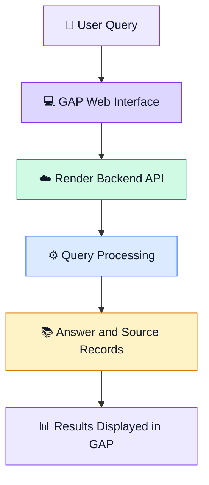

# ⚡ GAP — AI-Powered Competitor Intelligence

<p align="center">
  
  
  
  
</p>

<h3 align="center">
  Turning business claims into evidence-backed insights.
</h3>

<p align="center">
  GAP helps users investigate competitor activity, explore market developments, and examine the evidence behind business claims—all through a single web interface.
</p>

<p align="center">
  <a href="https://gap-frontend-mu.vercel.app"><strong>🚀 Live Demo</strong></a>
  &nbsp; • &nbsp;
  <a href="#-features">Features</a>
  &nbsp; • &nbsp;
  <a href="#-architecture">Architecture</a>
  &nbsp; • &nbsp;
  <a href="#-getting-started">Getting Started</a>
</p>

---

## 🌐 Experience GAP

**Live application:** https://gap-frontend-mu.vercel.app

Ask a question about a company, competitor, or market development. GAP returns an answer with supporting source records so you can investigate the information behind the response.

> **The idea:** Don't stop at an answer. Explore the evidence behind it.

## ✨ Features

<table>
  <tr>
    <td width="50%">
      <h3>🔎 Competitor Intelligence</h3>
      Explore reported competitor expansions, market activity, and competitive developments.
    </td>
    <td width="50%">
      <h3>🧠 AI-Powered Answers</h3>
      Turn natural-language questions into structured responses through the connected backend.
    </td>
  </tr>
  <tr>
    <td width="50%">
      <h3>📰 Evidence & Sources</h3>
      Review source titles, publication dates, and links returned with an answer.
    </td>
    <td width="50%">
      <h3>⚖️ Claim Investigation</h3>
      Examine business claims against available reporting instead of relying on unsupported assertions.
    </td>
  </tr>
  <tr>
    <td width="50%">
      <h3>🔗 Live API Integration</h3>
      Connect the web interface to a separately deployed backend for live responses.
    </td>
    <td width="50%">
      <h3>🛟 Fallback Experience</h3>
      Display saved results when the live-answer flow is unavailable, where supported by the application.
    </td>
  </tr>
</table>

## 🖥️ Demo

<p align="center">
  <a href="https://gap-frontend-mu.vercel.app">
    
  </a>
</p>

Open the application, submit a competitor-intelligence question, and explore the answer and its returned sources.

*Tip: Add a screenshot or GIF of the actual application here once you've captured one. A real product screenshot makes a GitHub README much more compelling.*

## 🏗️ Architecture



### Deployment

| Component | Deployment |
|---|---|
| Frontend | [Vercel](https://gap-frontend-mu.vercel.app) |
| Backend API | [Render](https://backend-gap.onrender.com) |
| Source control | GitHub |

The frontend communicates with the backend over HTTP. The backend returns answer data and associated source records for display in the application.

## 🛠️ Tech Stack

<p>
  
  
  
  
  
  
  
</p>

| Layer | Technologies |
|---|---|
| User interface | HTML, CSS, JavaScript |
| API communication | HTTP / REST-style endpoints |
| Backend hosting | Render |
| Frontend hosting | Vercel |
| Version control | Git, GitHub |

*The frontend stack is based on the current project files. Add any confirmed backend frameworks, AI models, databases, or external services once verified.*

## 📁 Project Structure

```text
frontend/
├── index.html          # Main application page
├── styles.css          # Interface styling
├── config.js           # Backend URL configuration
├── js/                 # Client-side application logic
├── data/               # Saved results and frontend data
└── README_FRONTEND.md  # Frontend documentation
```

## 🚀 Getting Started

### Prerequisites

- Python 3
- A modern web browser
- Network access to the deployed backend

### 1. Clone the repository

```bash
git clone <YOUR_REPOSITORY_URL>
cd <YOUR_REPOSITORY_NAME>
```

### 2. Navigate to the frontend

```bash
cd frontend
```

Adjust the path if the frontend files are already at the repository root.

### 3. Configure the API

Open `config.js` and set the backend base URL:

```javascript
window.GAP_CONFIG = {
  API_BASE: "https://backend-gap.onrender.com",
  API_PROBE_MS: 1200,
};
```

Use your own backend URL if it differs.

### 4. Start the local server

```bash
python3 -m http.server 5500
```

Open:

```text
http://localhost:5500
```

Keep the terminal running while testing the application.

## 🔌 Backend API

**Base URL:** https://backend-gap.onrender.com

Example endpoint observed during testing:

```http
POST /ask/eternal
```

A successful response may contain an answer and a list of source records:

```json
{
  "can_answer": true,
  "answer": "Summary of the available evidence...",
  "sources": [
    {
      "item_id": "n12",
      "signal": "news",
      "title": "Example article title",
      "source_url": "https://example.com/article",
      "date": "2026-09-24"
    }
  ]
}
```

*This is an illustrative response structure, not a guarantee that every request returns these exact fields or values.*

## 🧪 Testing Checklist

Before demonstrating GAP:

- [ ] The public frontend opens without requiring Vercel authentication.
- [ ] A fresh question produces a response.
- [ ] The request reaches the deployed backend.
- [ ] The API returns a successful response.
- [ ] Answer text and source records render correctly.
- [ ] Source links lead to relevant reporting.
- [ ] The interface handles failed requests appropriately.

## 🔐 Responsible Use

GAP presents information derived from available reporting. A returned answer or source record should not automatically be treated as definitive proof.

- Review sources before relying on a claim.
- Distinguish public reporting from direct company disclosures.
- Be aware that sources may be incomplete, outdated, or inconsistent.
- Keep API keys and credentials out of public repositories.
- Configure sensitive credentials through the appropriate hosting environment.

## 🔮 What's Next?

Potential improvements include:

- Claim-level evidence mapping
- Cross-source contradiction detection
- Source relevance and credibility scoring
- Historical competitor activity tracking
- Company comparison dashboards
- Confidence explanations and clearer verdicts
- Expanded automated testing and monitoring

## 👥 Team

Built collaboratively as a hackathon project.

**Project:** GAP — AI-Powered Competitor Intelligence

## 📄 License

No license has been specified. Add a `LICENSE` file if the team decides to distribute the project under an open-source license.

---

<p align="center">
  <strong>GAP — Better questions. Clearer evidence. Smarter decisions.</strong>
</p>

<p align="center">
  <sub>Built to make business intelligence more transparent and evidence-oriented.</sub>
</p>
